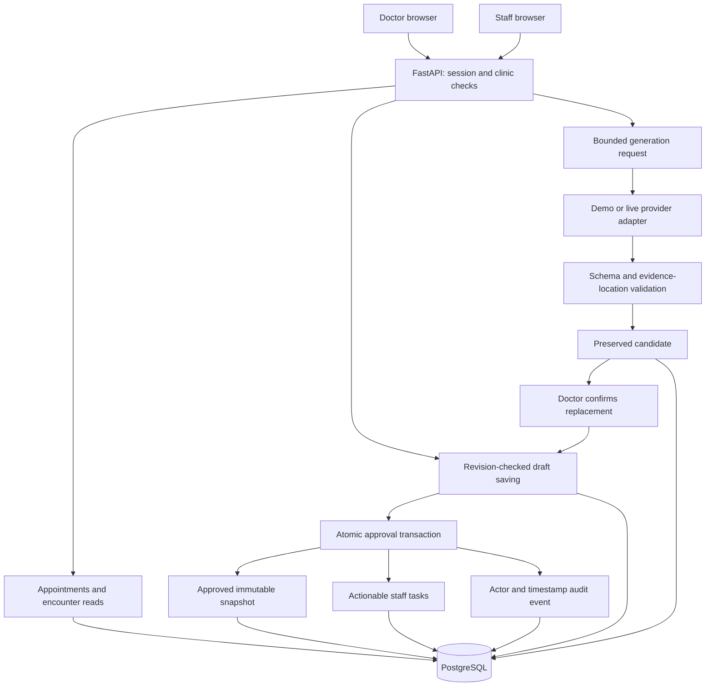

# Architecture

ClinicFlow is a modular Python API with a React client and PostgreSQL. Production packages frontend assets with the API into one container. Development runs Vite with an `/api` proxy. The same-origin browser interface uses an HttpOnly session cookie; no provider secret belongs in frontend code.

## Data model

| Entity | Responsibility and relationships |
| --- | --- |
| Clinic | Tenant boundary and local timezone |
| User | Clinic membership, doctor/staff role, password hash |
| Session | Hash of random browser token, expiration and revocation |
| Patient | Fictional demographic record belonging to a clinic |
| Appointment | Patient, visit time, reason, and encounter reference |
| Encounter | Editable/approved state, transcript and draft revision counters |
| Transcript revision | Immutable source text used to interpret historical evidence |
| Note version | Saved note, tasks, origin and evidence review metadata |
| Generation | Captured revisions, request identity, original provider output and candidate |
| Task | Approved follow-up, optional assignee, due date, and progress state |
| Audit event | Actor, action, timestamp, and limited event metadata |

SQL foreign keys and uniqueness constraints complement server authorization. Every clinic-owned query is scoped to the authenticated user's clinic, including guessed IDs. Staff do not receive encounter transcripts and can claim unassigned same-clinic tasks or update their own assigned tasks. Doctors control note editing, approval, and assignment. Authentication alone is never the authorization decision.

## State and concurrency

An encounter is `draft` or `approved`. Approval is irreversible in this MVP. The separate generation status is `idle`, `running`, `succeeded`, `failed`, or `stale`; a request does not lock a doctor out of editing.

Every saved transcript change increments `transcript_revision`. Draft changes independently increment `draft_revision`. Requests supply both observed revisions. A save with stale revisions returns 409 and keeps the user's local text available for reconciliation.

Generation captures both revisions and a request ID before calling the provider. A returned candidate is accepted only if both revisions still match, the encounter is still editable, and the request remains current. The same checks run again when the doctor applies the candidate. The client tracks local edits too, so unsaved work blocks automatic replacement even if the server revisions are unchanged. Generation never approves notes or creates actionable tasks.

Approval locks/validates the encounter in a transaction, records an immutable note snapshot, creates its tasks, writes an audit event, and changes the state. Repeated approval of the original approved revision returns the existing result. Database uniqueness prevents duplicate task creation under concurrent requests. Failed task creation rolls back the entire approval.

Claiming an unassigned task is atomic: only one eligible user wins. A second claimant receives a conflict instead of silently stealing ownership. Tasks with no assignee remain visible in the clinic's Unassigned queue.

## Evidence and human edits

The saved transcript is split into nonempty numbered lines (`s1`, `s2`, ...). An evidence reference includes a segment ID, exact quote, and immutable transcript revision. Validation checks that the cited location and quoted text exist. This is not a semantic correctness proof.

Original generations remain available in history. Editing an AI fact marks it doctor-edited and flags its original evidence for review; changing the transcript flags evidence from earlier revisions. Historical source text remains tied to the correct revision. Approval persists origin and review status after the doctor acknowledges flagged evidence. Acknowledgement does not claim the historical quote proves a changed fact.

## Operating boundaries

The API validates inputs, limits authentication and generation requests, bounds provider calls, and keeps provider errors separate from usable saved work. Logs must describe operations and errors without dumping clinical text, passwords, session tokens, or API keys. Health checks test database connectivity. PostgreSQL persists application state; no Redis, queue service, or microservices are required for the bounded MVP.

See [API contract](api-contract.md), [engineering decisions](decisions.md), [evaluation](evaluation.md), and [deployment](deployment.md). Implementation and test output are authoritative if an evolving detail differs from this overview.

